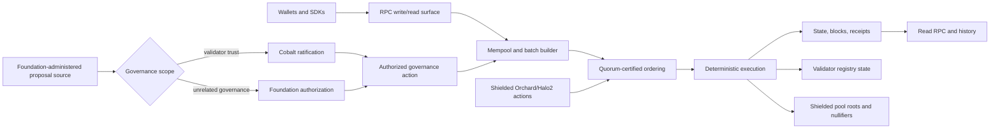

# Post Fiat L1 (PFTL)

**Whitepaper: [postfiat.org/whitepaper](https://postfiat.org/whitepaper/)**
(source in this repository: [docs/whitepaper.md](docs/whitepaper.md))

Post Fiat L1, also called PFTL, is a layer-1 settlement ledger written in Rust.
It follows the XRP Ledger model: a known validator set, deterministic finality
from quorum certificates, a fixed-supply native token (PFT) whose fees are
burned, and no validator rewards. It changes three things. Accounts and
validators sign with the post-quantum ML-DSA-65 scheme from genesis. Changes to
the validator set and trust graph are ratified on chain by a governance lane
called Cobalt. Private settlement runs through Asset-Orchard, a typed-asset
extension of Zcash Orchard with Halo2 proofs; that shielded stack itself is not
post-quantum. The main application is NAVCoins: floating-value assets whose
supply, minting and redemption are tied to machine-checkable reserve packets.

> **Status as of 2026-10-22: devnet only. See
> [Network Status](docs/status/network-status.md).**
>
> - One network runs today: the devnet `postfiat-wan-devnet-2`, run by six
>   Foundation-administered validators. Outside validators cannot join, and no
>   public RPC endpoint is published.
> - This is **not a production mainnet**, and no public testnet is open. Do not
>   put real value or real-value keys on it.
> - The code is **not externally audited**. See [SECURITY.md](SECURITY.md) and
>   the [security overview](docs/security/index.md).
> - Validator keys are plaintext software key files; HSM and remote signing are
>   not implemented. Validators need an explicit `--unsafe-devnet-file-signer`
>   acknowledgement. Long-running services on JSON/JSONL storage need
>   `--unsafe-devnet-json-storage`. The controlled devnet has used transactional
>   `redb` storage since height 930; its storage qualification remains open.

## Start here

| You want to | Read |
| --- | --- |
| Understand the design | [Whitepaper](docs/whitepaper.md), then [Architecture Overview](docs/architecture/overview.md) and [Settlement Lanes](docs/architecture/settlement-lanes.md) |
| Know what is running now | [Network Status](docs/status/network-status.md); the full dated log is [Current State](docs/status/chain-state-current.md) |
| Integrate an exchange or custodian | [Exchange Integration Guide](docs/integrate/exchange-guide.md) and [Addresses, Keys And Signatures](docs/integrate/addresses-keys-signatures.md) |
| Call the RPC | [RPC Overview](docs/rpc/overview.md), [RPC Methods](docs/rpc/methods.md), [Python Client](docs/python/quickstart.md) |
| Assess security | [Security](docs/security/index.md), [SECURITY.md](SECURITY.md), [Release Gate Inventory](docs/status/release-gate-inventory.md) |
| Decode a codename (A666, Z3, G4, Cobalt…) | [Glossary](docs/start/glossary.md) |
| Contribute | [First Day](docs/start/first-day.md), [Repo Map](docs/start/repo-map.md), [CONTRIBUTING.md](CONTRIBUTING.md) |
| Run a validator | [Validators](docs/validators/overview.md), [Public Operator Runbook](docs/runbooks/public-operator-runbook.md) |

The documentation home page is [docs/index.md](docs/index.md). Dated handoffs,
plans, reviews and status logs are internal engineering records, listed under
[Engineering Records](docs/index.md#engineering-records).

**For AI agents:** [AGENTS.md](AGENTS.md) is the internal workflow mandate for
the project's own contributor agents. To understand the system, start with the
pages above.

## How it fits together



- **Block finality** is Consensus v2, a prepare/precommit protocol. A block is
  final once it has a commit quorum certificate. With six validators the quorum
  is five ([Finality](docs/architecture/finality.md)).
- **Cobalt** ratifies validator-registry and trust-graph changes only. It does
  not order blocks ([Cobalt](docs/governance/cobalt.md)).
- **Settlement lanes**: consensus transactions, W6 two-party atomic swaps,
  FastPay single-owner payments, FastSwap two-owner delivery-versus-payment,
  and Asset-Orchard private settlement. Each has its own finality and recovery
  rules ([Settlement Lanes](docs/architecture/settlement-lanes.md)).
- **Halo2** is not reimplemented. The verifier uses Zcash's upstream
  `halo2_proofs` at a pinned commit, kept in-tree with a small patch for loading
  the pinned verifying key
  ([Halo2 Dependency](docs/security/halo2-dependency.md)).

## Build from source

Prerequisites: the Rust toolchain pinned in
[rust-toolchain.toml](rust-toolchain.toml) (with `rustfmt` and `clippy`), and
Python 3 for the tooling and docs.

```bash
scripts/check    # cargo fmt --check, cargo check, cargo clippy -D warnings, script syntax checks
```

Single local node (data in `.postfiat/node0`, chain ID `postfiat-local`):

```bash
scripts/node-init
scripts/node-run
scripts/node-status
scripts/node-faucet
scripts/node-transfer     # set TO=<address> AMOUNT=<atoms>
scripts/node-account      # set ADDRESS=<address>
```

Local multi-validator devnet (four validators by default; set `VALIDATORS=N`):

```bash
scripts/devnet-up
scripts/devnet-submit-transfer
scripts/devnet-status
scripts/devnet-down       # deletes devnet/local
```

The full test and gate commands (Rust, Python, wallet, contracts, docs) are in
[CONTRIBUTING.md](CONTRIBUTING.md).

## Build the docs site

```bash
python3 -m pip install --require-hashes -r requirements-docs.txt
scripts/docs-site-build
scripts/docs-site-serve --host 127.0.0.1 --port 8088
```

Then open `http://127.0.0.1:8088/`. The site is configured in
[mkdocs.yml](mkdocs.yml) and built from [docs/](docs/).

## Repository map

| Path | Contents |
| --- | --- |
| [crates/](crates/) | Rust workspace: types, crypto provider, execution, ordering, consensus and Cobalt, storage, network, privacy/Orchard, node, RPC SDK, bridge and proof crates |
| [python/](python/) | Python RPC client and wallet helpers (`postfiat_rpc`), operational safety tools (`postfiat_ops`), tests |
| [scripts/](scripts/) | Build checks, local node and devnet, release, evidence and docs scripts |
| [docs/](docs/) | Documentation source for the MkDocs site |
| [wallet-web/](wallet-web/), [wallet-extension/](wallet-extension/), [wallet-proxy/](wallet-proxy/) | Browser wallet, Chrome extension wallet, wallet RPC proxy |
| [programs/](programs/) | SP1 guest programs for bridge ingress, egress and receipt proofs |
| [third_party/](third_party/) | Vendored `fips204` (ML-DSA) and `halo2_proofs` sources |
| [systemd/](systemd/) | Example service units |
| [deployments/](deployments/), [benchmarks/](benchmarks/) | Internal engineering records: per-release deployment records and benchmark or campaign packets |

More detail: [Repo Map](docs/start/repo-map.md).

## Security, contributing and license

- Report vulnerabilities privately as described in [SECURITY.md](SECURITY.md).
  Do not open public issues for them.
- Contributions: [CONTRIBUTING.md](CONTRIBUTING.md) and
  [CODE_OF_CONDUCT.md](CODE_OF_CONDUCT.md).
- License: MIT or Apache-2.0, at your option ([LICENSE](LICENSE)).
